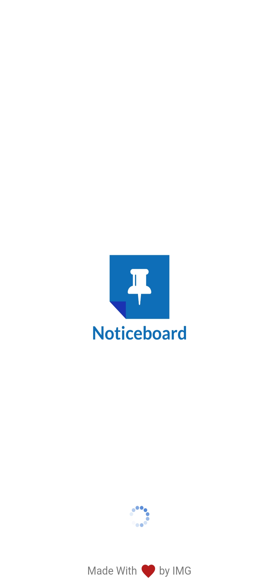
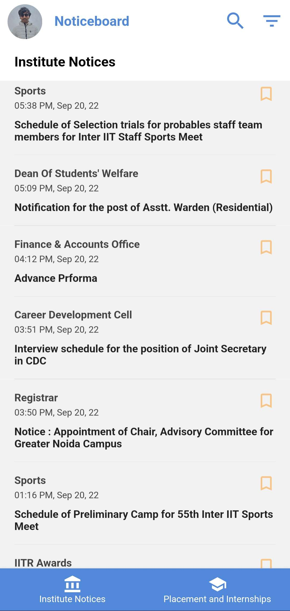
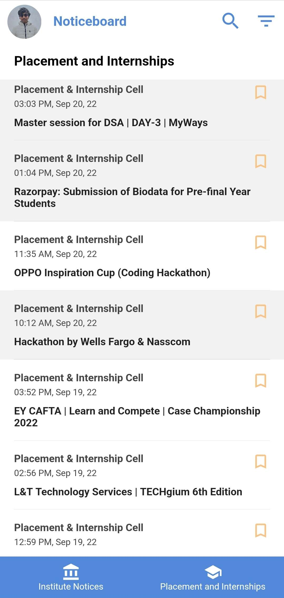
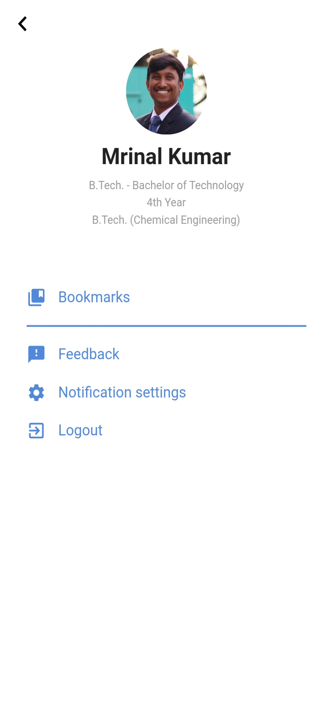
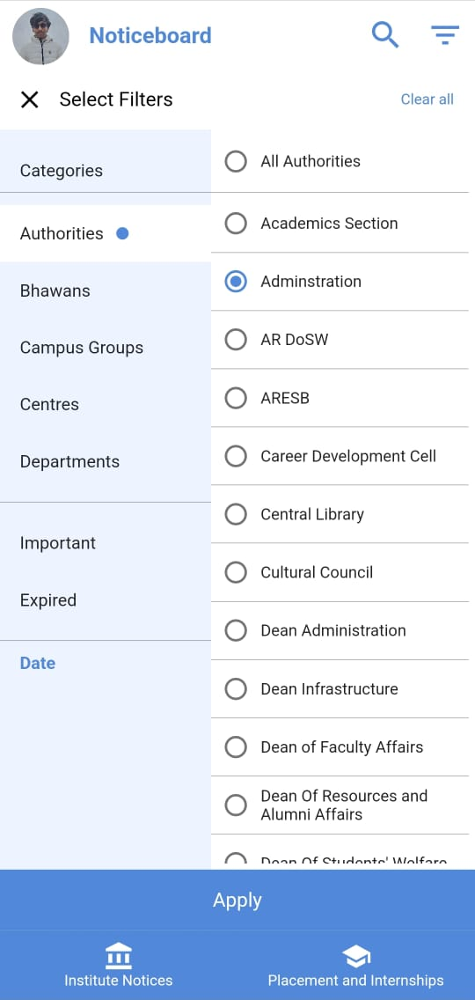
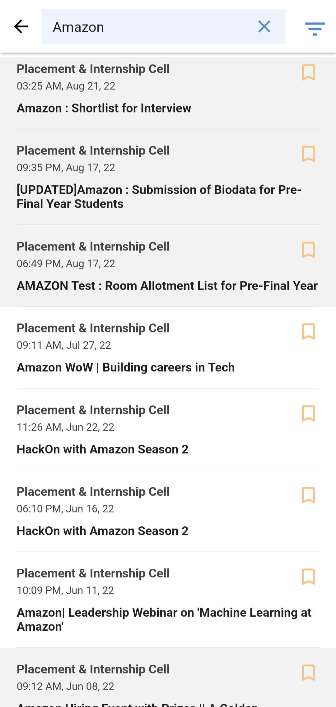
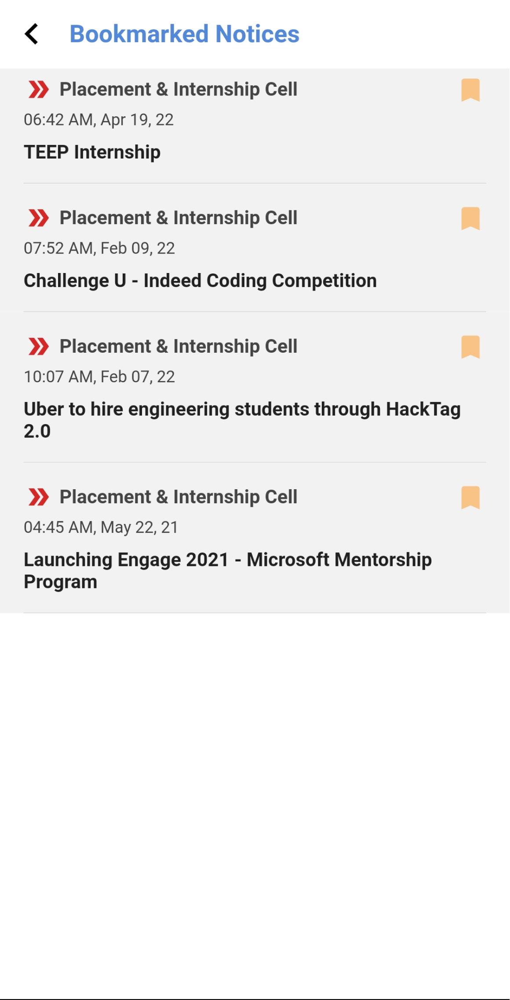

<div>
    
    <h1>Noticeboard V2</h1>
</div>

<div>
     &emsp;
     &emsp;
     &emsp;
     &emsp;
     &emsp;
     &emsp;
     &emsp;
</div>
</br>

## Download for Android

Get the APK from [Noticeboard V2 releases](https://github.com/HUKA-Taro/noticeboardv2/releases). If you previously installed a debug build of this V2 app, uninstall that build first and sign in again after installing the release.

## About the app
Noticeboard V2 is an unofficial, extensively modified Android app built on [IMG's Noticeboard Mobile App](https://github.com/IMGIITRoorkee/noticeboard-mobile-app). The original app and design are by the Information Management Group (IMG), IIT Roorkee. V2 changes are by HUKA_Taro.

The Android app uses your Channel i account to browse notices, search and filter them, and manage bookmarks.

## Features
- View notices without having to open Channel i, just login and you are set!
- Get alerts for new or updated notices when the custom backend is running.
- A separate tab for the ever important placement and intern notices.
- Use that search bar or filter for more fine results.
- Bookmark notices on the go!

## Terms of Service
Terms to Service: https://docs.google.com/document/d/1vsbooZi9PIiVIMaLts2wv0tODEJafCaRT41zsENYN3I/edit

## Privacy Policy
Privacy Policy: https://docs.google.com/document/d/1IPibdlVJNO8IZVQqOjBk7m4mFRXOD8RJFvrlRAMeV3s/edit

## Tech Stack
- `Flutter` for app code.
- `Firebase` for notifications.

## Contributing
- Fork the repository to your account.
- Branch out to `a_meaningful_branch_name`.
- Commit your changes.
- Add your name to `CONTRIBUTORS.md`.
- File a `Pull request`.
- Get your pull request merged.

It's that simple!

## Credits


## Noticeboard V2 by HUKA_Taro

> [!IMPORTANT]
> Automatic alerts require the custom backend described below.

This version includes notification improvements and Android testing tools:

- Requests Android notification permission and subscribes to the `noticeboard_v2_alerts` topic in the custom Firebase project.
- Receives new and updated notice alerts from a private backend through Firebase.
- Displays incoming FCM notification messages while the Android app is open, using a high-importance notification channel. Banners and sound depend on Android notification settings.
- Adds **Test notification now** and **Test notification in 30 seconds** to the profile menu in Android debug builds.
- Schedules the delayed test using Android's alarm scheduler so it can fire after the app is removed from Recents. The test receiver and alarm permissions are declared only in the debug manifest.
- Updates the Android Gradle Plugin to 9.1.1 and limits Gradle memory and parallel workers for local builds on machines with limited available memory.

### Testing notifications

1. Install a debug build, sign in, and allow notification permission.
2. Tap your profile picture and choose **Test notification now** to check local notification display.
3. Choose **Test notification in 30 seconds**, then remove Noticeboard from Recents. Wait for the scheduled notification. Do not use Android's **Force stop**, which prevents this test from running until the app is reopened.

The local debug notification buttons test display only. Automatic pushes require the V2 Firebase configuration and the private backend. Background alerts are displayed by Android after the app has been opened once and notification permission is allowed; Android force-stop prevents delivery until the app is opened again.

### Firebase setup for V2

Create a Firebase project you control and register an Android app with package name `com.huka.taro.noticeboardv2`. Download its `google-services.json` and replace `noticeboard/android/app/google-services.json`. Do not use IMG's old Firebase configuration for the V2 package.

**Automatic alerts require the custom backend.** The backend checks for updates and sends Firebase pushes while it is running. Other app features use Channel i. Contact [HUKA_Taro](https://github.com/HUKA-Taro) if you need access to host the checker locally.

To build an Android debug APK from the `noticeboard` directory:

```sh
flutter build apk --debug
```

The APK is written to `noticeboard/build/app/outputs/flutter-apk/app-debug.apk` relative to the repository root. The notification test menu is excluded from release builds.
